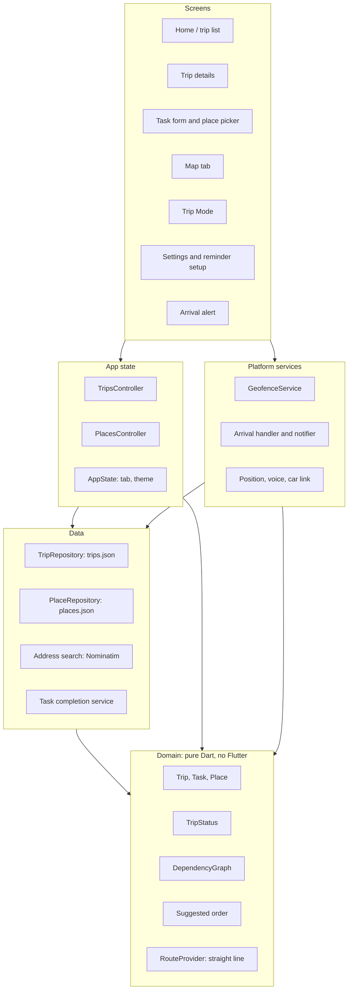
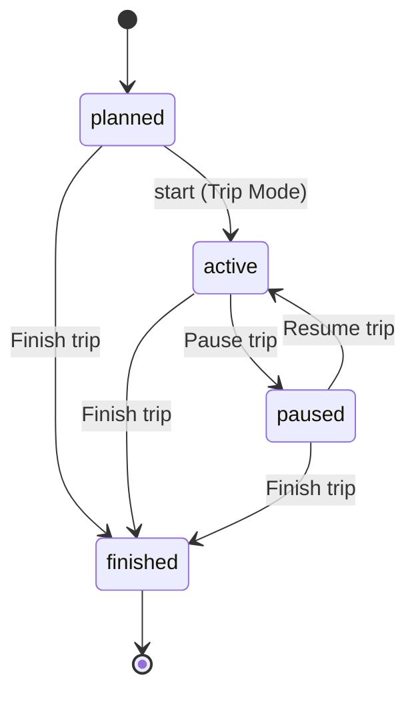

# How it works

[Back to the README](../README.md)

A technical overview for readers who want to know what is inside the app. The source code
is in a private repository; this page describes it as of **v0.8.1**.

- [Overview](#overview)
- [Architecture](#architecture)
- [Trips, tasks and their states](#trips-tasks-and-their-states)
- [The waiting rule](#the-waiting-rule)
- [The suggested order](#the-suggested-order)
- [Reminders and geofencing](#reminders-and-geofencing)
- [Trip Mode](#trip-mode)
- [Storage](#storage)
- [Map and search](#map-and-search)
- [Sharing a trip](#sharing-a-trip)
- [How releases are built](#how-releases-are-built)

## Overview

| | |
|---|---|
| App | Flutter (Dart), one code base for Android and iOS |
| Android | 7.0 (API 24) or newer, with Google Play services |
| iOS | 14.0 or newer (builds; not released yet) |
| State | Flutter's own `ChangeNotifier`, no state-management package |
| Storage | JSON files in the app's private folder |
| Map | OpenStreetMap through `flutter_map` |
| Reminders | the operating system's geofencing through `native_geofence`, notifications through `flutter_local_notifications` |
| Trip Mode | `geolocator` for position, `flutter_tts` for the phone's own text-to-speech |
| Sharing | Supabase (`supabase` package): Postgres functions, anonymous sign-in, row-level security, Realtime |

## Architecture

The app is split into layers. Each layer only uses the layers below it.



- **Domain** holds the rules: the models, trip states, the dependency graph and the order
  algorithm. It has no Flutter or platform code, so it is tested with plain unit tests.
- **Data** reads and writes files and talks to the search server.
- **Platform services** wrap geofencing, notifications, position, text-to-speech and
  Bluetooth behind small interfaces. The tests replace them with fakes, so no test touches
  real hardware or the network.
- **Screens** never change a file directly; they go through the controllers.

## Trips, tasks and their states

A **trip** has a title, a date, a status and a list of tasks. A **task** has a title, a
place (name, latitude, longitude), a reminder radius of 50 to 500 m, a trigger (arrive,
leave or both), an optional note, the ids of the tasks it waits for, and whether it is done.

A trip's status follows a small state machine. Any other move, including a move to the same
status, is refused.



- **Finished is final.** A finished trip can't change. The app refuses to complete a task
  of a finished trip from anywhere, including an old notification.
- **Completing a task is final** too. A done task never goes back to not done.
- The home screen groups trips by status and date: **Active** (started, or planned for today
  or earlier), **Upcoming** (planned for a later day) and **History** (finished).

## The waiting rule

Tasks in a trip form a **directed graph**: an edge from B to A means "B waits for A".

- A task is **ready** when it is not done and every task it waits for is done.
- It is **locked** (blocked) when at least one of them is not done.
- A task that waits for a task no longer in the trip stays locked and is reported as
  "Waits for a task that is missing".
- **No cycles.** Before a prerequisite is added, the graph checks whether the new edge would
  let a task reach itself (directly or through others). The task form doesn't offer those
  choices and says how many were left out.
- **The rule is enforced where a task is completed**, not only in the screens. Completing a
  locked task is refused by the completion service, whether it comes from the trip screen, a
  notification, the arrival alert, Trip Mode or the Map tab. For shared trips the sharing
  server enforces the same rule again in its own `complete_task` function.

## The suggested order

The order is a **greedy nearest-neighbour** search over the tasks not done yet, constrained
by the waiting rule:

1. If the phone's position is known, start there. Otherwise try **each ready task as the
   first stop** and run the steps below for each one.
2. From the current stop, go to the **nearest task that can be done next**: one whose
   prerequisites are all done or already placed earlier in the order.
3. Repeat until no task is left. Tasks that wait for a missing task go last.
4. Without a starting position, keep the candidate with the **shortest total distance**.
   Ties keep the trip's own order.

Distance is the **straight-line (Haversine) distance**, through a `RouteProvider` interface
so a road-distance provider can replace it later without touching the algorithm. The app
shows **distances only**; it never estimates a time, an arrival time or a trip duration.

The user sees the order with each step's distance and chooses **Use this order** or
**Keep my order**. The app never reorders a trip by itself.

## Reminders and geofencing

The app does not track your position itself. It hands a list of circles (**regions**) to the
operating system's geofencing (Android's Play services `GeofencingClient`, iOS's
`CLLocationManager`), and the system wakes the app when the phone enters or leaves one, even
when the app is closed.

**Which regions.** One region per task that is not done, in trips that are not finished.
The phone allows a limited number per app (**Android 100, iOS 20**), so they are ranked:

1. ready tasks of active trips
2. locked tasks of active trips (arriving there says what to do first)
3. tasks of paused trips (arriving there reminds you to resume)
4. tasks of trips planned for a later day (watched early so they work from the first moment
   of their day; until then an arrival says nothing)

Within each group the nearest come first, measured from the last position the system
reported. When there are more tasks than the limit, the farthest of the last group are left
out.

**Keeping them in line.** The region list is recalculated whenever trips change, after the
reminder setup and when the app comes back to the screen. Only the difference is sent to the
system (removals first, so additions fit under the limit). The list is saved in
`regions.json` and registered again after a reboot or an app update, even if the app is not
opened.

**From event to reminder.**

```mermaid
sequenceDiagram
  participant OS as OS geofencing
  participant H as Arrival handler (background)
  participant L as reminder_log.json
  participant N as Notifications
  OS->>H: enter / exit region (trip id, task id)
  H->>H: load trips; is the trip remindable now?<br/>does the task's trigger match?
  H->>L: shown before for this visit?
  alt new
    H->>N: "You arrived at Pharmacy" or "Locked: complete X first"<br/>or "Don't forget your trip" (paused)
  end
  N-->>H: Complete / Later / tap
  H->>H: Complete goes through the completion service<br/>(waiting rule, finished-trip rule)
```

- Each visit reminds once. Leaving clears it, so coming back reminds again.
- A paused trip gives one "Don't forget your trip" reminder per arrival, even when several of
  its places are close together.
- Tapping the reminder opens a full-screen alert, over the lock screen on Android when the
  system allows it.

## Trip Mode

Trip Mode reads the phone's position with `geolocator` while it is open and shows the
**next stop**: the first task that can be done now in the suggested order, with its
straight-line distance. Spoken prompts use the phone's own text-to-speech engine; no voice
data is bundled or sent anywhere.

The car is noticed through Bluetooth connection events: a connected device whose class is
car audio or hands-free counts as the car. The app never scans for devices. When the car
connects and a trip is under way (or planned for today) with a task left, the app offers
Trip Mode once per trip while it runs.

## Storage

Everything is stored as JSON in the app's private documents folder.

| File | Contents | Format id |
|---|---|---|
| `trips.json` | all trips and tasks | `georeminder.trips`, version 1 |
| `places.json` | frequent places | `georeminder.places`, version 1 |
| `regions.json` | regions registered with the system, last reported position | |
| `reminder_log.json` | reminders already shown for the current visit | |

**Safe saves.** A save writes `trips.json.tmp`, moves the current file to `trips.json.bak`,
then moves the new file into place. A crash at any step leaves either the old or the new
trips readable. Loading falls back to the backup when the main file is missing or damaged,
and a damaged file is kept aside instead of being overwritten. Saves are queued, so two
never interleave.

**Unknown fields are kept.** The JSON reader keeps fields it does not know, so a file written
by a newer version is not stripped by an older one.

**Export format.** A versioned trip file format (`georeminder.tripfile`) is in the code
and tested, so older files can still be imported later. The export and import screens come
in a later version.

## Map and search

- Map squares come from `tile.openstreetmap.org`, loaded only for the area on screen, with
  the attribution always shown, following the OpenStreetMap tile usage policy.
- Address search uses Nominatim, following its usage policy: it runs only when the user
  presses search, at most one request per second, with an identifying User-Agent, and
  repeated searches are answered from memory.
- **Navigate** hands the place to the phone's maps app. GeoReminder does no routing itself.

## Sharing a trip

Sharing arrived in v0.7.0, and doing a shared trip together in v0.8.0. The server side is a
Supabase project (Postgres, anonymous auth, row-level security, Realtime), kept as SQL
migrations with automated SQL tests in the backend repository.

- **Identity:** anonymous sign-in plus a nickname. No email, phone or password. The session
  is kept on the phone, so the same anonymous user comes back after a restart.
- **Server functions:** the app does not write the tables directly; it calls Postgres
  functions to share a trip, make a new code, join, read the trip and its participants,
  complete a task (`complete_task`) and stop sharing.
- **Codes:** 6 characters, valid **10 minutes**, one active code per trip. At most **10
  people** per trip.
- **Checks on the server:** sharing refuses a trip with a dependency cycle or a task that
  waits for a missing one, and limits the size of what one call can store. `complete_task`
  enforces the waiting rule and answers `BLOCKED` for a locked task. Only the owner can make
  a new code or stop sharing.
- **Row-level security:** a user who is not on a trip can't read or change it.
- **Errors:** each server error code maps to its own message in the app (wrong or expired
  code, full trip, offline, server waking up, sharing stopped elsewhere).
- **Editing:** a shared trip is read-only on every phone, so the copies can't drift apart.
  Stopping sharing deletes the trip on the server; the owner's phone keeps it as a normal trip.
- **Completing:** a completion on a shared trip is saved on the phone first, then sent with
  `complete_task`. If two people complete the same task, the server keeps the first
  completion and every phone shows that one.
- **Live updates:** while the app runs, each shared trip that isn't finished listens on
  Supabase Realtime: one channel for task changes and a separate one for new participants,
  both filtered to that trip. Row-level security applies to Realtime too, so only people on
  the trip receive its changes. The channels connect only after the signed-in session is
  restored, and a problem on the participants channel never stops task updates.
- **Catching up:** when the app starts, comes back to the front, reconnects, or a trip is
  opened, it reads the whole trip from the server and applies what it missed.
- **Offline queue:** a completion that can't be sent stays queued in the phone's storage and
  is sent at the next sync, including after a restart. Prerequisites are sent before the
  tasks that wait for them.
- **Who completed what:** each task keeps the user id of whoever completed it. The phone
  keeps the nicknames of the trip's participants in the trip file, saved before applying
  new completions, so a card can say "Done by Lina" and Trip Mode can announce it. The
  nicknames are never uploaded with the trip and stay after sharing stops.
- **Sharing stopped:** when the server answers that the trip no longer exists, a member's
  phone turns it into a normal local trip and keeps its completions.
- Positions are never uploaded, shared trips included.

## How releases are built

Every release in this repository is built automatically:

1. Each change to the app goes through automated checks: formatting, static analysis and
   the full test suite (889 tests at v0.8.1).
2. When a version is merged, the pipeline builds the Android APK and publishes a release
   with its notes in the private source repository.
3. A scheduled job in this repository copies each new release here, with the same notes,
   the APK and its SHA-256 checksum.
